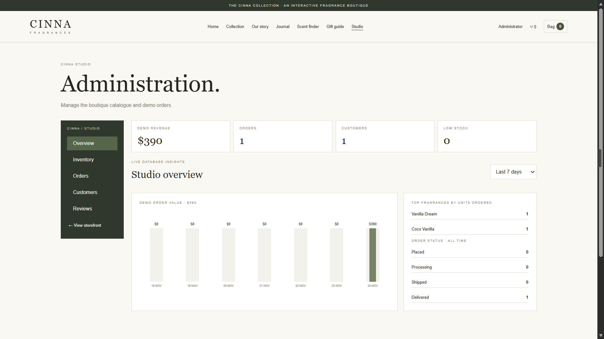

# Cinna Fragrances

A premium fragrance boutique and full-stack e-commerce portfolio application, rebuilt from a PHP/MySQL database project using the PERN stack.

## Live Demo

[Explore Cinna Fragrances ->](https://cinna-fragrances.onrender.com)

## Website preview

### Homepage

### Product Collections

### Admin Dashboard

## Experience

- Twenty original fragrance listings with responsive product photography, search, concentration filters and sorting.
- Customer registration, sign-in, persistent shopping bag and wishlist, inline quantity controls, live bag count and feedback.
- Editorial campaign imagery, scent-family discovery, illustrated fragrance journal and clearly labeled fictional scent stories.
- Guest bag stored in the browser, atomic account cart transfer using maximum quantities for overlapping items, and a quick-access bag drawer.
- Interactive scent finder, three-product comparison, budget and stock filters, gift edits, recently viewed products, image enlargement, and product link sharing.
- Six editorial journal articles and a client-care FAQ.
- Simulated checkout with transactional stock updates, order history and delivery status.
- Verified delivered-purchase reviews.
- Role-protected administration for catalogue, inventory, orders, customer overview and review moderation, with modal editing, image preview, database-driven analytics, separate workspace tabs, search, inventory and order filters, and CSV reporting.
- Order restoration and downloadable demo order summaries.

## Architecture

React and Vite render the storefront. Express serves JSON REST endpoints and the production frontend. PostgreSQL stores accounts, hashed session tokens, products, carts, wishlists, orders, item price snapshots and reviews. Passwords use salted scrypt hashes; SQL queries use parameters. Checkout uses a transaction and row locks to protect stock and compute totals on the server.

## Technology

PostgreSQL · Express · React · Node.js · Vite · CSS · Helmet

## Repository

`frontend/` contains the storefront and optimized original images. `backend/` contains the API, database initialization and security tests. `database/` contains the PostgreSQL schema and original product catalogue.

## Project scope

This is a fictional storefront for demonstration purposes, not an operational retailer. Checkout does not collect payment information or arrange real delivery. Catalogue prices are demo USD amounts retained from the original numerical dataset. Customer and order data from the original project were intentionally excluded. Original catalogue image ownership and licensing should be verified before public publication. Campaign and atelier imagery are AI-generated illustrative assets; fictional testimonial examples are not actual customer reviews.

## Status

Source implementation includes automated security and shopping-logic tests. The final revision passes eight dependency-free tests and JSX syntax validation. A production build and browser/database integration check are required to verify the final revision.
